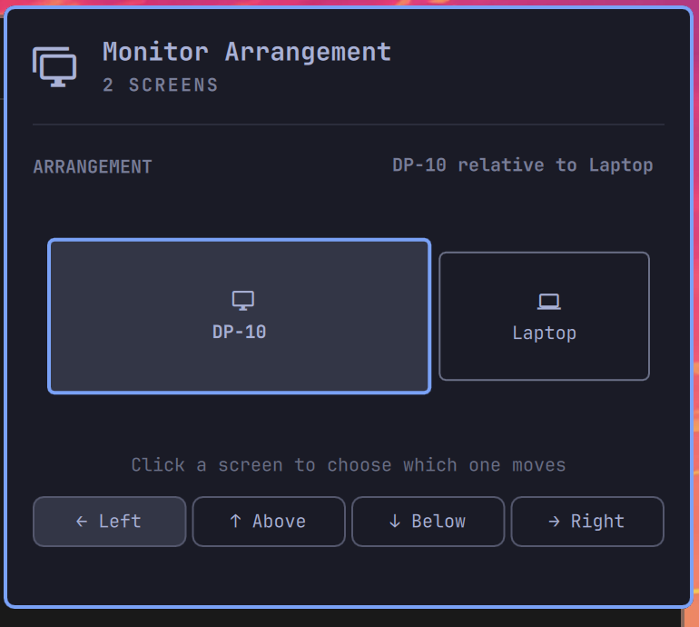

# Monitor Arrangement

An Omarchy shell plugin that lets you arrange your monitors from the bar. Open
it to see your screens drawn to scale, pick one, and put it to the left of,
above, below or to the right of the other. The new layout applies at once and
is saved to `~/.config/hypr/monitors.lua`, so it survives reboots.



## Features

- **To-scale map**: screens are drawn by their real logical size (resolution
  divided by scale), so a laptop at 2x and an ultrawide at 1x look right.
- **One click to move**: Left / Above / Below / Right place the chosen screen
  next to the laptop screen, centred along the shared edge. The current side is
  highlighted.
- **Choose the screen**: click a screen in the map (or use j / k) to choose
  which one the buttons move.
- **Saved for you**: positions are written into the rules already in
  `monitors.lua`, matched by connector name (`DP-1`) or by description
  (`desc:...`). A screen with no rule gets one added after Omarchy's default
  rule, the same way Omarchy's own scale setting does.
- **Safe**: the file is replaced in one write, and if Hyprland reports config
  errors after the reload, the previous file is put back. The last version is
  also kept as `monitors.lua.arrange-bak`.
- **Keyboard**: j / k pick the screen, h / l pick a direction, Enter applies.
- **Follows your theme** like the other bar panels.

## Requirements

Omarchy with the Quattro shell (`omarchy-shell`) and Hyprland's Lua config
(`~/.config/hypr/monitors.lua`). It uses `python3` and `hyprctl`, which Omarchy
already includes.

## Install

```bash
omarchy plugin add https://github.com/Kunush/omarchy-monitor-arrangement --enable
```

Or place it in the bar yourself, for example next to the Display widget:

```bash
omarchy bar put kunush.monitor-arrangement --after omarchy.monitor
```

## From a terminal

The helper script works on its own too:

```bash
python3 ~/.config/omarchy/plugins/kunush.monitor-arrangement/arrange.py layout
python3 ~/.config/omarchy/plugins/kunush.monitor-arrangement/arrange.py place DP-1 left
python3 ~/.config/omarchy/plugins/kunush.monitor-arrangement/arrange.py place DP-1 above eDP-1
```

`place <screen> <left|right|above|below> [<anchor>]` moves `<screen>` next to
`<anchor>` (default: the laptop screen, or the first other screen). Other
screens keep their place relative to the anchor.

## Notes

- Omarchy's Scale buttons re-apply a screen with `position = "auto"` until
  Hyprland next reloads its config. The saved layout comes back on that reload.
- Only rules written on a single line are edited; multi-line rules are left
  alone, and a new single-line rule is added instead.

## License

MIT
